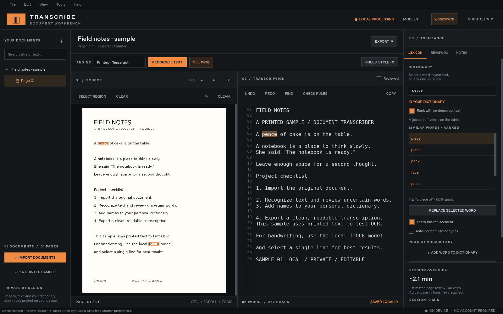
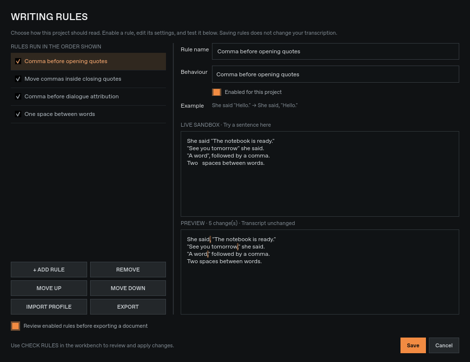
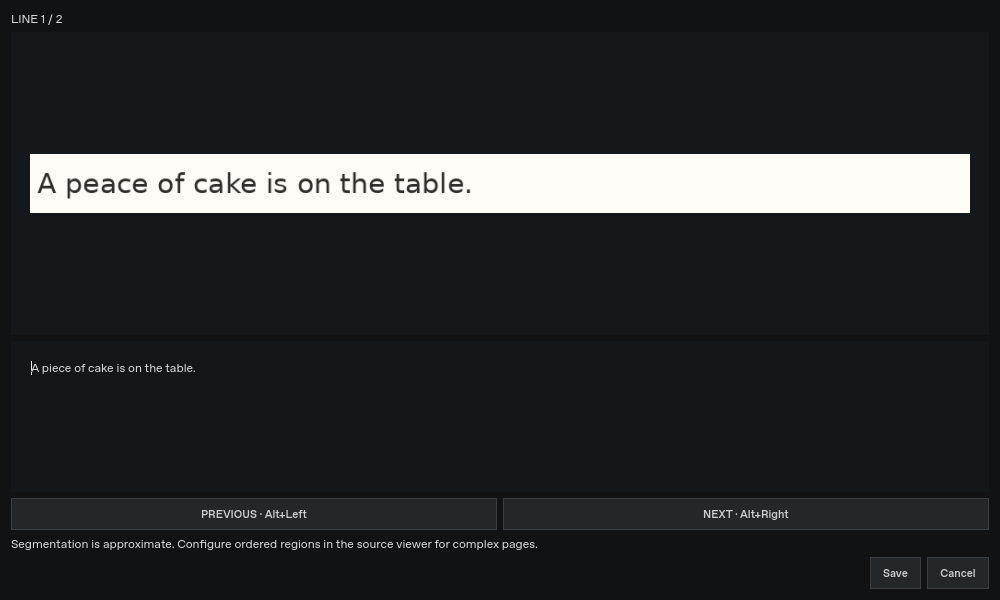
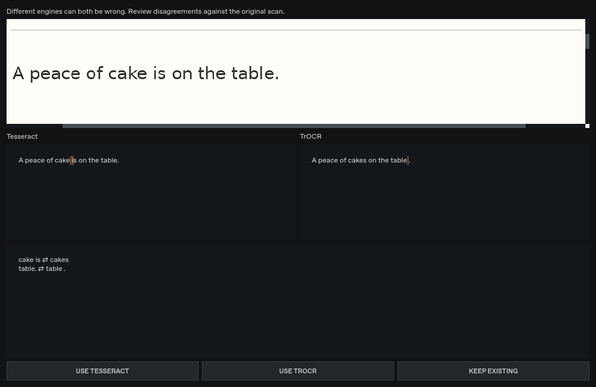

# Document Transcriber

A browser version with drag-and-drop images and local OCR lives in [web/](web/README.md). It is prepared for GitHub Pages; the native desktop app remains below.

A local-first desktop transcription workbench for **ChromeOS Crostini and Linux**.
Charcoal surfaces, orange accents, square controls. No account, web server, or API key.



## Run on ChromeOS

Enable the Linux development environment in ChromeOS Settings, then open its Terminal.
ChromeOS forwards Linux GUI windows to the desktop automatically. Share an external
ChromeOS folder with Linux before importing documents from it; shared files appear
under `/mnt/chromeos`.

```bash
sudo apt update
sudo apt install -y python3 python3-venv tesseract-ocr tesseract-ocr-eng \
  libegl1 libopengl0 libgl1 libxcb-cursor0 libxkbcommon-x11-0 libxcb-icccm4 \
  libxcb-keysyms1 libxcb-shape0 libxcb-xinerama0 fonts-dejavu-core
git clone https://github.com/thatsockmonke/Document-transcriber.git
cd Document-transcriber
python3 -m venv .venv
.venv/bin/python -m pip install -e '.[dev]'
.venv/bin/document-transcriber
```

Python 3.10+ is required. For repeatable dependencies, use `uv sync --locked --extra dev`
instead of pip. The committed `uv.lock` covers the app, tests, and optional backend.
The optional, separately installed handwriting backend is described below.

If Qt reports a platform plugin error, first install the system libraries above.
If the Crostini Wayland integration is unavailable, try
`QT_QPA_PLATFORM=xcb .venv/bin/document-transcriber`.
Do not use `offscreen` for interactive desktop use.

On ARM Chromebooks, availability of Qt/PyTorch wheels depends on the Python version
and architecture. The application does not assume an x86 CPU; the install scripts
detect the architecture and use PyPI for ARM PyTorch. ARM hardware has not been tested.

## Workflow

1. Import images, multipage TIFFs, or PDFs using **Ctrl+O**, drag-and-drop, or clipboard
   image import (**Ctrl+Shift+V**). Originals are copied into the project.
2. Choose **Printed · Tesseract** or **Handwriting · TrOCR** and press **Ctrl+R**.
   Full-page recognition asks before replacing existing text and can be undone.
   **Tools → Recognize blank pages in document** processes the remaining blank pages
   in the selected document. Existing transcriptions are never overwritten; cancelling
   a batch leaves all its pages unchanged.
3. For handwritten material, **Select region**, drag around a single line, place the
   editor cursor, and recognize. The result replaces the editor selection or inserts
   at the cursor. Full-page handwriting segmentation is experimental and works best
   on clean, separated horizontal lines. TrOCR is trained on English handwriting.
4. Click recognized text on the image to select its transcription. Uncertain Tesseract
   words are highlighted. The review tab collects low-score readings and spelling
   issues. Editing invalidates alignment for the words you changed; unchanged words
   retain their coordinates. Undo restores text, but not discarded OCR coordinates.
5. Select a word to see spelling alternatives. Approve replacements, add names to the
   project vocabulary, or use **Ctrl+Space** for completions. Auto-correction is **off
   by default** and only uses replacements you explicitly taught the app. The bundled
   English dictionary is a spelling dictionary, not a definition service.
   **Rank with sentence context** uses nearby words to reorder similar spellings,
   including valid-word confusions such as “form/from” and “peace/piece”. Orange
   suggestions have local context evidence; select one to see the explanation.
   Pages marked reviewed teach the project vocabulary and phrasing. Unreviewed OCR
   is not used as training material. Learned auto-corrections apply to misspellings;
   changes between correctly spelled words remain suggestions.
6. Type notes, mark a page reviewed, and export the current document as TXT, Markdown,
   DOCX, or JSON. TXT/Markdown/DOCX contain the transcription; JSON additionally
   includes page notes, OCR metadata, and review state.

Text and notes autosave after a short pause and when changing pages or closing.
Each project contains `project.sqlite3` and an `images/` directory. **File → Back up
project** creates a consistent ZIP snapshot, including original scans and vocabulary.
To restore, extract it into an empty folder and use **File → Open project**. A project
can only be open in one app instance at a time.

Rotate, clean, and reset scans without overwriting their original image. Processing
clears old coordinates but preserves the transcription. The review-time estimate is
`word count / configured review words per minute`; it is a planning aid, not a measure
of handwriting difficulty or OCR accuracy. Adjust it in Tools.

## Handwriting recognition (optional, local)

```bash
./scripts/install-handwriting.sh
```

Restart the app and open **Models**. Install the supplied
`transcriber-handwriting-model.zip` to avoid downloading the weights, or choose
**Download model** for a one-time download of `microsoft/trocr-small-handwritten`
(~247 MB on disk, ~148 MB as a compressed pack). Model packs contain weights and
tokenizer files; the Python dependencies above and Tesseract system package are
separate prerequisites. An offline model pack is not a complete offline installer.
The script installs CPU PyTorch on x86 Linux, avoiding large CUDA packages. Allow
roughly 2 GB for the environment and working memory; actual use depends on the
document. The model loads only when needed and is cached for the application session.

The model is pinned to revision `b4648cfa171985a6745f37ddd637e98c0da958ac`.
Every file is checked against the app's expected SHA256 before first loading, and
packs are verified before replacing an existing install. You can export a verified
pack from **Models** and import it on another computer. Failed or cancelled pack
operations preserve the previous install. `--model-dir` selects a verified model
directory at launch.

Downloads require HTTPS access to `huggingface.co` and its artifact hosts, including
`cas-bridge.xethub.hf.co`, `cas-server.xethub.hf.co`, `transfer.xethub.hf.co`, and
`cdn-lfs.hf.co`. Use your network administrator's supported allowlist settings.
Model downloads keep TLS verification enabled; never bypass verification to install.
After the model is installed, inference uses local files only. The download does not
upload document images. The app never fetches a model automatically when opening a
document. Handwriting quality varies; always review the result. TrOCR results have
line-level alignment and no calibrated word-confidence score, so they are listed
as **Unscored** in the review queue.

Printed OCR and manual transcription work independently of this optional download.

## Writing rules

Choose **Rules & Style** to set project-specific preferences. All presets start
disabled. The builder includes a live sandbox and before/after highlighting:

| Preference | Example |
| --- | --- |
| Comma before opening quotes | `She said "Hello."` → `She said, "Hello."` |
| Move commas inside closing quotes | `"Hello", she said.` → `"Hello," she said.` |
| Comma before dialogue attribution | `"Hello" she said.` → `"Hello," she said.` |
| Curly or straight quotes | `"Hello"` ↔ `“Hello”` |
| Single spaces | Collapse repeated internal spaces; preserve indentation |
| Remove trailing whitespace | Preserve line breaks |
| Custom replacements | Literal phrases, optional whole-word and case matching |

Rules run in the displayed order; move them up or down to control the result.
Profiles can be imported/exported as JSON. User rules do not execute code or
arbitrary regular expressions. Comma-before-quote is a style preference applied to
paired double quotes, including titles if present; enable it only where that fits
the source material. Dialogue attribution preserves existing `?` and `!` endings.

**Check Rules** (**Ctrl+Shift+K**) reviews proposed changes. Approve individual
changes, keep the original, or apply all checked changes as one undoable edit.
With **Review enabled rules before exporting** enabled, every page in the exported
document is checked. Saving a rule profile never rewrites the document by itself.

The bundled dictionary context model is under 1 MB and uses an English bigram/trigram
model trained on 1.05 million words of public-domain prose, with local adaptation
from reviewed pages. It ranks plausible phrases rather than understanding meaning.
Its corpus provenance, checksum, and original notices are included in the app data.



## Development

```bash
./scripts/setup.sh
QT_QPA_PLATFORM=offscreen .venv/bin/python -m pytest
.venv/bin/ruff check src tests scripts
.venv/bin/document-transcriber --demo
```

`scripts/setup.sh` uses uv when available, puts its cache under `/workspace/.cache`
in the cloud environment, and installs from the frozen lockfile. It does not install
system packages; use the apt command above if Qt/Tesseract are missing.

For a writable cloud-local data directory:

```bash
QT_QPA_PLATFORM=offscreen .venv/bin/document-transcriber \
  --data-dir /workspace/document-transcriber-data
```

Omit `QT_QPA_PLATFORM=offscreen` on your Chromebook. `--data-dir` sets the settings and
model location; `--project /path/to/project` selects a different project folder.
The `--demo` option imports an explicitly labeled **printed** sample; it does not
pretend to demonstrate handwriting recognition. The sample deliberately includes
“a peace of cake” and a quotation without a preceding comma so you can try context
suggestions and project-specific writing rules.

The release archive `document-transcriber-0.3.0-with-models.zip` includes the app
wheel, handwriting pack, installation instructions, and Linux launch helpers.
Extract it in Crostini, read `START-HERE.txt`, run `bash install.sh`, then
`bash run.sh`. The installer needs Internet access for Python dependencies;
the handwriting weights and dictionary context model are already included.

Prepare or bundle the model (handwriting dependencies must be installed first):

```bash
.venv/bin/python scripts/prepare-models.py --model-dir /path/to/trocr-small-handwritten \
  --pack dist/transcriber-handwriting-model.zip
```

Add `--verify-only` to verify/export without networking. To rebuild the bundled
context model from its pinned, checksummed source corpus, run
`.venv/bin/python scripts/build-context-model.py`. Source notices are preserved.
`scripts/validate-handwriting.py` runs an offline single-line smoke test against a
supplied reference and reports character edit rate; it is not an accuracy benchmark.

## Current scope

Implemented: local projects, multipage import, real printed OCR, optional TrOCR
handwriting inference and portable model packs, image/text alignment, region OCR, context-ranked spelling suggestions,
learned corrections, completions, personal vocabulary, review queue, notes, image
cleanup, literal find/replace, undo/redo, autosave, backups, progress estimates, and
five export formats, declarative writing rules, live rule previews, selective
approval, rule checks across document exports, and reusable rule profiles.

Future work: trained layout analysis for complex handwriting, table recognition,
multilingual model selection, rich formatting, definitions,
model quantization, and packaged Chromebook releases. There is no
cloud OCR fallback, generative semantic correction model, or claim of guaranteed recognition.


## Workspace tools (0.3)

The **Workspace** menu adds these local workflows:

- **Line-by-line transcription** (`Ctrl+L`): enlarged scan line above its editable text;
  `Alt+Left/Right` navigates, and Save applies the transcription as one undoable edit.
  Automatic segmentation is approximate; ordered regions override it for columns/margins.
- **Compare two OCR engines**: run Tesseract and TrOCR, inspect highlighted disagreements
  alongside the scan, then accept one reading or keep the current text. Both engines
  can be wrong. Select a handwritten line first for a useful comparison.
- **Split / merged-word review**: inspect suggestions such as `note book → notebook`
  and `alot → a lot`, approving one at a time.
- **Writer profiles & terminology**: save names, letter-shape observations, approved
  corrections and abbreviations for each writer, plus starter medical/legal/historical/
  academic vocabulary packs. Paste additional vocabulary into the profile. Abbreviations
  are reviewable writing rules. Profiles do not fine-tune neural weights.
- **Writer training examples**: save selected line crops with verified text and export
  image/JSONL pairs for an external fine-tuning workflow. The app does not perform
  neural training. These deliberately saved examples remain in the project backup.
- **Faithful / cleaned copies**: maintain separate editable readings for each page.
  The active copy is exported; switching copies preserves both. Scans remain immutable.
- **Revision history** (`Ctrl+H`): compare autosaved text versions with source labels
  and restore a version as an undoable edit. Revisions are retained in project backups.
- **Processing queue**: enqueue blank pages, prioritize, pause after the current page,
  resume, and retry failures. Completed work and queued jobs survive restarts. Start
  resumes manually; it never overwrites an existing transcription.
- **Scan correction**: deskew, background normalization/bleed-through reduction, and
  four-corner perspective correction. Originals remain available through Reset scan.
  These are basic image-processing tools, not learned document restoration.
- **Reading order**: select and add numbered regions; reorder or remove coordinate rows,
  then recognize the regions in that order. This supports columns and margin notes.
- **Accessibility & shortcuts**: high contrast, adjustable editor font, and editable
  menu shortcuts with duplicate checks. The interface uses no animated transitions.
- **Unload handwriting model** releases model references when idle; the allocator may
  retain memory for reuse until the application closes.

Writing rules now support dialogue/outside-dialogue scope, line-level phrase exceptions,
explicit D/M/Y or M/D/Y-to-ISO date normalization, sentence capitalization, and literal
preferred-capitalization replacements. Invalid calendar dates remain unchanged.

**Searchable PDF** export retains scan images and adds an invisible Unicode text layer
containing the active transcription. The layer reflows edited text independently of
image coordinates, so search works but selection boxes need not match handwriting.

For Fedora KDE/Wayland, install `python3 python3-pip tesseract tesseract-langpack-eng
qt6-qtwayland` with dnf. Launch with `QT_QPA_PLATFORM=wayland bash run.sh` from the
extracted bundle. To add a user-local launcher, run `python3 scripts/install-desktop.py`
after installing. On Crostini the launcher appears among Linux apps. Actual Fedora
and Chromebook desktop sessions have not been tested; Linux Qt tests run offscreen.




